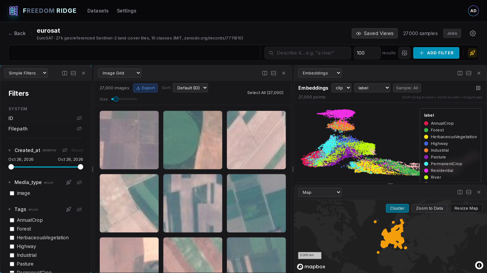

# Freedom Ridge

**Freedom Ridge** (FRIDGE) is a self-hosted tool for exploring and curating computer vision
datasets. It is for teams whose image data has outgrown the tool they started with: millions of
samples, served whole, without sampling and without truncation.

<div align="center">
  
  <p><em>Filters, grid, embeddings and map in sync: all 27,000 EuroSAT tiles, coloured by land-cover class</em></p>
</div>

## Features

- **Nothing is hidden.** The view is the truth. Limits are signalled and escapable, never silent:
  no quiet caps, no truncated counts, no "showing the first 1,000".
- **Maps.** GPS locations, a map panel and polygon filters for aerial, satellite, street-level
  and driving imagery.
- **Vector search.** Text, image and reverse-image similarity search and concept probes over CLIP
  embeddings, or any vectors you upload, stored in PostgreSQL with pgvector.
- **Server-side filtering.** Filter by metadata, time, geography, labels or any custom field.
  Filters run in the database, not the browser, and use indexes where they exist.
- **Labels and objects.** Boxes, masks, keypoints, polylines and 3D boxes, plus an objects view
  with one row per annotation.
- **Python SDK.** `fridge` ingests, queries, tags, embeds and versions datasets from scripts.

Freedom Ridge is deliberately narrow. It is the data layer (ingest, index, search, curate,
version), not an experiment tracker or a model zoo. The design target is to stay fast with
millions of samples in one dataset.

## Relationship to other tools

Freedom Ridge is an independent project in the same space as tools such as Voxel51's FiftyOne,
and some SDK names (`Dataset`, `Detections`, `sort_by_similarity`) will look familiar to their
users. It is not a fork or port of FiftyOne: it has its own server, storage model (PostgreSQL with
pgvector) and API. Freedom Ridge is not affiliated with or endorsed by Voxel51.

## Why "Freedom Ridge"?

In 1995 the US Air Force took a hilltop in Nevada. It had no name until a researcher who had been
documenting the base gave it one: from twelve miles out, Freedom Ridge was the closest public ground
with a clear view of the base at Groom Lake. Closing it, along with nearby White Sides, took a formal
petition to the Bureau of Land Management to withdraw 3,972 acres of public land.

We named a dataset tool after it for one reason. This product has exactly one rule, written down
and enforced on the server: you get to see all of it.

## Try it locally

**With Docker and Node.js** (from 2.5.0):

```bash
npx freedomridge
```

It starts the release's published images from `~/freedomridge` and opens http://localhost:3000; run it again
with a newer version to upgrade, and `npx freedomridge stop` to stop. More in
[launcher/README.md](launcher/README.md).

**With only Docker** (from 2.2.0): download a release and start its published images.

```bash
curl -L https://github.com/freedomridge/freedomridge/archive/refs/tags/vX.Y.Z.tar.gz | tar xz
cd freedomridge-X.Y.Z
docker compose -f docker-compose.try.yml up -d
```

Open http://localhost:3000 and log in as `admin` / `admin123`, then set a new password. Put
images in the folder's `data/`; the SDK (`pip install "freedomridge==X.Y.Z"`) connects to
`http://localhost:8000/api`. Set `MAPBOX_TOKEN` (in the shell or a `.env` file) for the map. It's
for one machine only: the credentials are the development ones and the ports listen on
`127.0.0.1`.

**To develop**, follow the [Quick Start](docs/QUICK_START.md). It needs no domain name
and no TLS certificate: PostgreSQL runs in Docker, and the backend and frontend run from your
checkout. You need Docker with Compose v2, Python 3.14 with [uv](https://docs.astral.sh/uv/),
and Node.js 26.

The Quick Start clones the repository and starts the database, the backend on
http://localhost:8000 and the frontend on http://localhost:3000. You log in as `admin` /
`admin123`, set a new password, and create an API token for scripts.

## Load demo data

With the app running, `FRIDGE_DATA_ROOT` set and an API token exported (see the Quick Start):

```bash
python examples/download_demo_data.py --datasets coco
python examples/import_demo_data.py --datasets coco --limit 100
```

[examples/README.md](examples/README.md) covers COCO, Open Images, iNaturalist, KITTI and more,
with disk sizes, import times and each dataset's licence.

## Python SDK

```bash
pip install freedomridge
```

Install a release of your server's major version: an SDK and a server of different major versions
refuse each other. In a clone, `uv sync` installs the SDK from `python/`.

The base package needs only `requests`, `numpy`, `Pillow` and `tqdm`. The extras are
`embeddings`, `huggingface-embeddings`, `patch-embeddings`, `metrics`, `hashes`, `quality` and `all`
(`pip install "freedomridge[all]"`).

Create a token in **Settings → API Tokens**, then:

```python
import fridge
from fridge import Dataset, Sample

fridge.connect("http://localhost:8000/api", api_token="...")  # or set FRIDGE_API_URL and FRIDGE_API_TOKEN

ds = Dataset("my_dataset")  # loads the dataset, or creates it (creating needs an admin token)
ds.add_samples([
    # Local paths must be inside the backend's FRIDGE_DATA_ROOT; s3:// URIs also work.
    Sample("/path/to/data/0001.jpg", tags=["train"], metadata={"category": "dog"}, location=(-122.4, 37.8)),
])

s = ds.samples
for sample in s[(s.category == "dog") & s.tags.contains("train")].limit(10):
    print(sample.filepath, sample.metadata)

ds.compute_embeddings()  # CLIP, computed on this machine; needs the `embeddings` extra
similar = s.all().sort_by_similarity(text="a dog on a beach")
```

Filters can also be written as text, checked against the dataset's fields:
`ds.query("category in (dog cat) AND score >= 0.5")` ([docs/FILTER_QUERY.md](docs/FILTER_QUERY.md)).

[docs/SDK.md](docs/SDK.md) is the full reference, and [docs/AUTHENTICATION.md](docs/AUTHENTICATION.md)
covers accounts, roles and tokens.

## Deploy

Production runs the whole stack from `docker-compose.prod.yml`: nginx with TLS, the frontend, the
backend, a job runner, a cache worker, a backup sidecar and PostgreSQL. It needs a DNS name for the
host, and you generate `POSTGRES_PASSWORD`, `FRIDGE_ADMIN_PASSWORD` and `STORAGE_ENCRYPTION_KEY`
and set `DOMAIN_NAME` and `ALLOWED_ORIGINS` before the first start. To try the app without a
domain, use the Quick Start.

- [Deploy to AWS](docs/DEPLOY_TO_AWS.md): one EC2 instance, created with Terraform.
- [Docker deployment](docs/DOCKER_DEPLOYMENT.md): any Linux host with Docker.
- [Upgrading](docs/UPGRADING.md) to a new release, and the [changelog](CHANGELOG.md).
- [Followers](docs/FOLLOWERS.md): a second instance that keeps read-only mirrors of chosen datasets.
- [On-demand compute workers](docs/ON_DEMAND_WORKERS.md): AWS machines started for heavy jobs, then gone.

## Architecture

PostgreSQL 18 with PostGIS and pgvector holds samples, labels, embeddings and statistics. A
FastAPI backend serves the API and media, and a separate job runner process does long work
(statistics, duplicate and concept upkeep, map re-fits, deletions, backups). The Next.js frontend
and the Python SDK both use the same API. In production, nginx terminates TLS.

```
backend/        FastAPI app: routers/, db/schema.sql, db/migrations/, tests/
frontend/       Next.js app: app/, components/, lib/, e2e/, tests/
python/fridge/  SDK: core/client.py, core/dataset.py, core/sample.py, core/view.py
examples/       demo-data downloaders and importers, SDK recipes
scripts/        migration, backup and maintenance scripts
ops/            Terraform, nginx and TLS files for production
docs/           guides and design notes
```

## Troubleshooting

- Database: `docker compose logs db`, and check the extensions with
  `docker compose exec db psql -U freedomridge -d freedomridge -c '\dx'`.
- Backend errors about missing tables or columns on an existing database: apply the migrations
  (see [CONTRIBUTING.md](CONTRIBUTING.md#database-migrations)).
- The map panel stays empty: set `NEXT_PUBLIC_MAPBOX_TOKEN` in `frontend/.env.local` and restart
  the frontend. Everything else works without it.

## Contributing, security and licence

See [CONTRIBUTING.md](CONTRIBUTING.md) for development setup, the full set of checks, and
migrations. Please follow the [Code of Conduct](CODE_OF_CONDUCT.md), and report vulnerabilities
privately as described in [SECURITY.md](SECURITY.md).

MIT License; see [LICENSE](LICENSE). Third-party components and datasets keep their own licences;
see [THIRD_PARTY_NOTICES.md](THIRD_PARTY_NOTICES.md).

Built with [FastAPI](https://fastapi.tiangolo.com/), [Next.js](https://nextjs.org/),
[PostgreSQL](https://www.postgresql.org/) with [pgvector](https://github.com/pgvector/pgvector)
and [PostGIS](https://postgis.net/), [OpenAI CLIP](https://github.com/openai/CLIP) and
[Mapbox](https://www.mapbox.com/).
