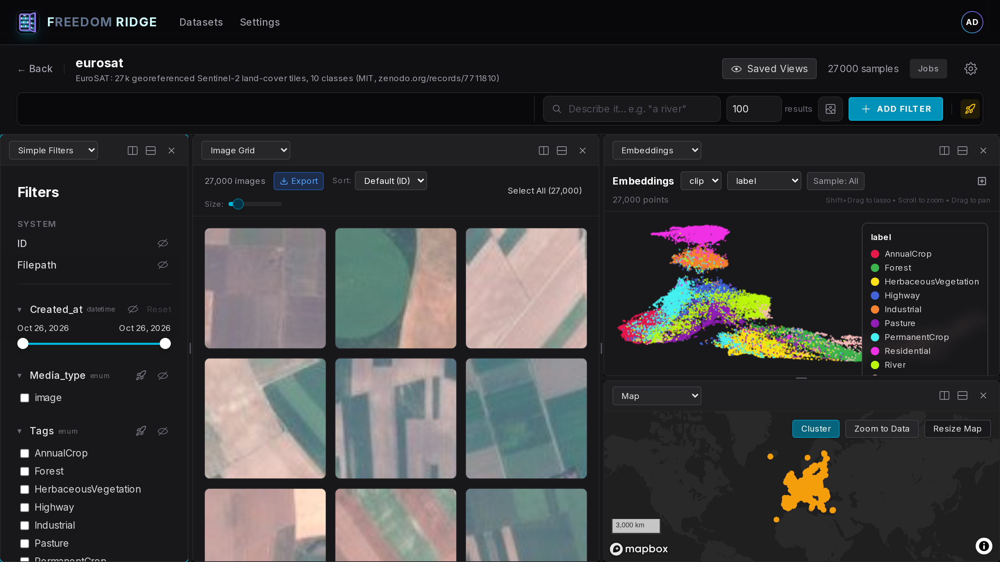

# Satellite Embeddings in Freedom Ridge — EuroSAT, End to End

> Voxel51's [OlmoEarth + FiftyOne post](https://voxel51.com/blog/olmoearth-fiftyone-satellite-embeddings)
> showed a nice satellite workflow: embed Sentinel-2 tiles, reduce with UMAP, and "watch your data
> self-organize" — scatter, map, and grid in sync. This is **the same workflow in Freedom Ridge,
> from the raw GeoTIFFs, in one script** — and then two steps further: **learned concepts** and
> the **object/patch grain**.

**The pitch in one line:** ingest 27,000 georeferenced satellite tiles with labels, locations, and
embeddings *in the same transaction*, and be lassoing clusters, drawing map polygons, and running
similarity searches minutes later — with nothing capped, sampled, or hidden along the way.



## Perceptual hashes and duplicates

Imports include `dhash_8` and `phash_8` on image rows so the **Duplicates** panel
and **collapse duplicates** work for matching images. Object rows receive no hashes.
Use `--hash-algorithms dhash_8 phash_8` to choose algorithms or `--no-hashes` to omit
them; both flags also work with `examples/import_demo_data.py`.
Hashes use the rendered RGB JPEG pixels, matching an SDK backfill of the served file.

Resume skips existing rows without rehashing. Backfill an older dataset from the
repository root using [the SDK recipe](../sdk/compute_hashes.py), with API credentials
and access to the media files:

```bash
python examples/sdk/compute_hashes.py eurosat --algorithms dhash_8 phash_8
```

Backfill skips objects and images with all requested hashes, computing only missing
fields. See [shared hash options](../README.md#perceptual-hashes-and-duplicates).

## The dataset

[EuroSAT](https://zenodo.org/records/7711810) (MIT license): **27,000 multispectral 64×64 Sentinel-2
tiles** across 10 land-cover classes — `AnnualCrop`, `Forest`, `HerbaceousVegetation`, `Highway`,
`Industrial`, `Pasture`, `PermanentCrop`, `Residential`, `River`, `SeaLake` — each tile a
georeferenced GeoTIFF (13 bands, UTM). Small enough to run on a laptop over coffee, real enough to
show every panel doing its job.

## Run it

Follow the [demo prerequisites](../README.md#prerequisites): running backend,
`FRIDGE_DATA_ROOT`, an API token, and CLIP weights cached once. Install `rasterio`
for GeoTIFF reprojection. The source is the all-bands
[torchgeo mirror](https://huggingface.co/datasets/torchgeo/eurosat/resolve/main/EuroSATallBands.zip).

```bash
python examples/download_demo_data.py --datasets eurosat
python examples/import_demo_data.py --datasets eurosat --limit 100
# Limit is per class; 0 imports all 27k tiles.
python examples/eurosat/ingest.py --data-root "$FRIDGE_DATA_ROOT/eurosat" --limit 0
```

The shared toolkit handles token/password authentication, cached-only CLIP,
resume before image decoding, containment, the first-batch media check and UMAP
only after writes. Defaults remain dataset `eurosat`, field `clip`, limit 100
per class and batch size 128. CPU and GPU elapsed times were not recorded for
the original full import; benchmark a small subset on your machine.

Per tile the script: reads the GeoTIFF → computes the tile-center **lat/lon** (rasterio, UTM →
EPSG:4326) → renders an **RGB JPEG** from bands B04/B03/B02 → **CLIP-embeds** it locally (GPU if
available) → creates the sample with `label`, `location`, and the embedding **inline, one
transaction**. Then it refreshes stats and builds the embedding map **client-side**, with a
RAM-scaled UMAP fit and coordinates for every embedded tile, at any dataset size.

### Bring your own model (the OlmoEarth option)

Freedom Ridge deliberately doesn't compute embeddings for you — *the uploader owns derived fields*.
The script uses CLIP because it's a one-liner, but any Earth-observation model
([OlmoEarth](https://huggingface.co/allenai/OlmoEarth-v1-Base), SatMAE, Prithvi…) drops in the same
way: put its vector on the sample at ingest, under its own field name.

```python
Sample(
    filepath=str(jpg),
    location=(lon, lat),
    metadata={"label": class_name},
    embeddings={"olmoearth": olmo_vec, "clip": clip_vec},  # as many fields as you like
)
```

Each field name establishes its own dimension on first write; a wrong-dimension upload is rejected
with a 422 (it can't silently poison the field). Two models = two entries in the scatter's field
dropdown — same tiles, two geometries, switch live.

## The tour

### 1. The scatter self-organizes

Open the dataset → **Embeddings** panel. The UMAP scatter is already there, and with **Color by →
`label`** the picture snaps into the blog's money shot: water pools into its own continent
(`SeaLake`/`River`), crops and pasture form a vegetation archipelago, `Residential`/`Industrial`
fuse into an urban landmass. Nobody told the model what a forest is — 512 CLIP dims did.

**Lasso** any cluster and the grid scopes to it instantly. The lasso is a *server-side region
filter*, not a client-side selection of downloaded points — so it works exactly the same on this
27k-tile demo and on multi-million-sample datasets, and it never silently drops points.

### 2. The map — and the three-way link

Open the **Map** panel: every tile sits at its true location, scattered across Europe. Freedom
Ridge's map is a hybrid renderer — cluster bubbles where points are dense, individual points where
they're sparse, all individual points once you zoom in — with the hard rule that *the full dataset
stays reachable* (bubbles never truncate, viewport queries are exact).

Now do the blog's Sweden trick: **draw a polygon** around Sweden on the map. The grid and the
scatter re-scope live to Swedish tiles only. Then go the other way — lasso the water cluster in the
scatter and watch the map light up along coastlines and lakes. Map ⇄ grid ⇄ scatter are three views
over one filter state, whichever one you drive.

The same filter exists in the SDK:

```python
from fridge import Dataset, geo_within

sweden = [[11.0, 55.3], [24.2, 55.3], [24.2, 69.1], [11.0, 69.1], [11.0, 55.3]]  # [lon, lat]
ds = Dataset("eurosat")
view = ds.samples[geo_within(sweden)]
print(view.count())
```

### 3. Similarity search

Click a `River` tile in the grid, hit **Find Similar** — the grid re-ranks the dataset by embedding
distance (pgvector, dataset-scoped, server-side). Rivers first, then lake shores, then irrigated
field edges: the model's notion of "riverness", ranked. From the SDK:

```python
ref = view.first()
similar = ds.samples.all().sort_by_similarity(ref, limit=50)
```

Or skip picking a reference tile and just **describe** it — the semantic-search box in the
query bar (or `text=` in the SDK) CLIP-encodes your words and ranks the whole dataset.
Measured on this dataset: *"a river"* returns 9/10 `River` tiles, *"an industrial site with
buildings"* 10/10 `Industrial`, in ~0.1s once the text tower is warm:

```python
rivers = ds.samples.all().sort_by_similarity(text="a river", limit=50)
```

### 4. Concepts — teach it what the labels don't say  *(beyond the blog)*

EuroSAT's 10 labels are coarse. Suppose what you actually care about is **"open water"** — which
cuts across `SeaLake` and `River` and sneaks into a few `Pasture` tiles with ponds. In the
**Concepts** panel: select a handful of water tiles as ＋ examples, optionally a couple of lookalike
false friends (dark forest) as −, and Freedom Ridge fits a direction in embedding space and scores
**every tile 0–1** against it. Then use the concept's view switch to *show-only*, *exclude*, or
rank — and tune the cutoff live. It's a classifier's worth of curation for five clicks, no training
loop, and it keeps improving as you mark more ± examples. New tiles streaming in later? Concepts
can auto-score just the new arrivals, hourly.

Concepts are scriptable too:

```python
water = [s.id for s in ds.samples[ds.samples.label == "SeaLake"].limit(5)]
forest = [s.id for s in ds.samples[ds.samples.label == "Forest"].limit(3)]  # hard negatives
concept = ds.create_concept("open-water", seed_ids=water, neg_ids=forest, kind="probe")
ds.concept_preview(concept["id"], op=">", threshold=0.7)  # -> {"matched": ...}

# ...or from words alone (no example clicks):
concept = ds.create_concept("river-like", prompt="a river crossing the landscape")
```

### 5. The patch grain — when the thing you want is smaller than a tile  *(beyond the blog)*

A 64×64 EuroSAT tile is already a fine grain, but real satellite work is full-scene: one Sentinel-2
scene is 10,980×10,980 px, and the thing you're hunting — a solar farm, a new building, a ship —
is a few dozen pixels of it. Whole-scene embeddings describe the *scene*; the needle hides.

Freedom Ridge's answer is the **object/patch grain inside the same dataset**: tile each scene into
a grid of patches, embed each patch (`examples/sdk/compute_patch_embeddings.py --scales 4x4 8x8`), and
the grid's **Images/Objects toggle** pivots between scenes and patches — cross-linked both
directions. Confirm one example of what you're looking for and **Find Unlabeled** probes every
patch across the whole dataset for lookalikes, whether or not any detector ever drew a box there.

## Why this is fast in Freedom Ridge (and stays fast)

The blog's workflow is a great demo; the reason we built Freedom Ridge is what happens at 100× the
size:

- **Ingest is streaming and transactional.** Labels, location, and embeddings land in one request
  per batch, indexed as they arrive. No load-then-compute-then-sync pipeline to babysit.
- **Interactive queries run server-side.** The scatter samples via precomputed even-coverage ranks
  (~0.2s to first paint on millions of points), lasso/map/facets run as SQL over indexes, and
  similarity is a pgvector query — the browser never downloads "the dataset".
- **Nothing is silently capped.** Facets, map, scatter, and selections signal limits and always
  keep the full data reachable — a bubble is a promise of points, not a summary that ate them.
- **Map building at any size:** the importer uses `Dataset.compute_visualization()` client-side,
  scales the UMAP fit to available RAM, and projects *all* points. To rebuild a map for an older
  dataset in an authenticated SDK session, use
  `Dataset("eurosat").compute_visualization(field_name="clip")` with your dataset name.
  For million-vector similarity, build the HNSW index once with `scripts/build_ann_indexes.py`;
  inserts self-maintain from then on.

| Blog step (FiftyOne + OlmoEarth) | Here |
|---|---|
| Load georeferenced tiles | `Sample(filepath, location=(lon,lat), metadata={"label": …})` |
| Attach 768-d embeddings | `embeddings={"olmoearth": vec}` inline at ingest (dim-validated) |
| UMAP → Embeddings panel | client-side, RAM-scaled `compute_visualization()` (any size) |
| Color by class / uniqueness | scatter **Color by** any field · `compute_uniqueness()` in the SDK |
| `dataset.geo_within(polygon)` | `ds.samples[geo_within(polygon)]` · or draw it on the map |
| Lasso ⇄ map ⇄ grid sync | same three-way link, server-side, uncapped |
| Similarity index + sort | **Find Similar** / `sort_by_similarity()` (pgvector) |
| — | **Concepts**: learned 0–1 scores from ± clicks, auto-scored on new data |
| — | **Object/patch grain**: scene ⇄ patch pivot, `Find Unlabeled` lookalike hunt |

## Notes & honesty

- **Media serving:** the RGB renders must live under the backend's `FRIDGE_DATA_ROOT` (that's why
  `--data-root` should point there). The GeoTIFFs themselves are read only at ingest.
- **RGB render:** B04/B03/B02 clipped at reflectance 2750 with a gamma 1.5 lift (true-color
  vegetation is near-black without it); tune `REFLECTANCE_MAX`/`GAMMA` to taste. Embeddings are
  computed on these RGB renders; a multispectral model (OlmoEarth) would read the GeoTIFFs instead.
- **`refresh_stats()` matters:** it's what registers `label` for the Filters sidebar and the
  scatter's color-by dropdown. The script calls it; if you ingest your own way, don't skip it.
- **Similarity without an ANN index** is an exact scan — ideal at 27k (perfect recall, still
  instant). For million-vector fields run `scripts/build_ann_indexes.py` once per field.
- **Verified:** this example was run end-to-end against a live Freedom Ridge stack before being
  committed — all 27,000 tiles ingested and UMAP-reduced. Measurements from that run: teaching + scoring the `open-water` concept over all 27k vectors
  took **0.6s**; `sort_by_similarity` over 27k with no ANN index took **0.13s**;
  `geo_within(iberia)` returned 3,009 tiles.

## Credits

- EuroSAT: Helber et al., [*EuroSAT: A Novel Dataset and Deep Learning Benchmark for Land Use and
  Land Cover Classification*](https://arxiv.org/abs/1709.00298) (MIT license,
  [Zenodo](https://zenodo.org/records/7711810), fast mirror courtesy of
  [torchgeo](https://huggingface.co/datasets/torchgeo/eurosat)).
- Workflow idea: [Voxel51 — *Exploring OlmoEarth Satellite Embeddings in
  FiftyOne*](https://voxel51.com/blog/olmoearth-fiftyone-satellite-embeddings), and Ai2's
  [OlmoEarth](https://allenai.org/blog/olmoearth-embeddings) models.

## Offline tests and shared verification

```bash
PYTHONPATH=python:. python -m pytest examples/eurosat -q
python examples/_shared/verify.py --kind eurosat --dataset-name eurosat \
  --api-url http://localhost:8000/api --expected-count 1000 --expect-reduced
```

The count above matches the default 100 tiles in each of ten classes. For a smaller
local subset, pass its actual count. The fixture test checks the GeoTIFF center,
RGB rendering and stable source/filepath metadata without a backend or network.
